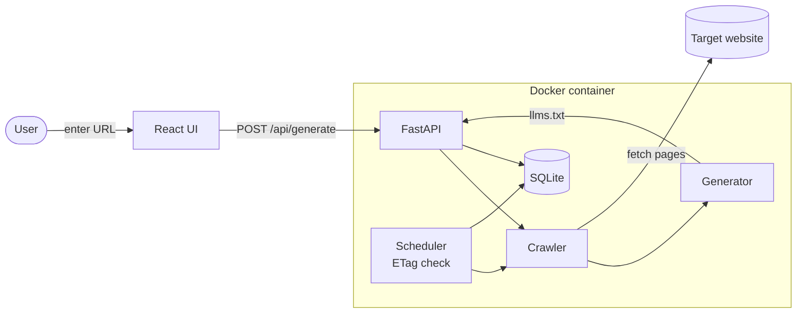

# llms.txt Generator — Plan

A web app: enter a website URL, get back an `llms.txt` file that follows the
[llmstxt.org](https://llmstxt.org) spec. Optionally monitor the site and regenerate
the file when it changes.

**v1 scope:** only what the assignment asks for. Extras go under [Later](#later-not-in-v1).

## Tech stack

| Layer | Choice |
|---|---|
| Backend | Python 3.12, FastAPI, `httpx`, BeautifulSoup |
| Storage | SQLite only (via SQLAlchemy), on a persistent volume |
| Scheduler | APScheduler, in-process (ETag check per site, daily by default) |
| Frontend | React + Vite + TypeScript, served by FastAPI |
| Packaging | One Docker image |
| Hosting | Railway (always-on, with a volume for the SQLite file) |

## Architecture

## How it works

1. **Crawl:** a best-first crawl (always fetch the highest-scoring links next) picks the ~50 most important
   pages, using sitemaps, nav links and page scores. → [docs/crawler.md](docs/crawler.md)
2. **Extract:** pull each page's title, description and markdown version (if any).
3. **Generate:** build a spec-compliant llms.txt (H1, summary, H2 link sections,
   `## Optional`) and validate it. → [docs/llms-txt-format.md](docs/llms-txt-format.md)
4. **Monitor:** every day (configurable), each stored site gets an ETag check on its
   homepage, sitemaps and listed pages. If any ETag changed, the site is re-crawled
   automatically and the new llms.txt is stored if it differs. → [docs/monitoring.md](docs/monitoring.md)
5. **Store:** everything lives in one SQLite file: sites, version history and
   pages. → [docs/database.md](docs/database.md)

API, components and repo layout: [docs/architecture.md](docs/architecture.md)

Classes, how they interact, and pseudocode for every file: [docs/code-walkthrough.md](docs/code-walkthrough.md)

## Testing while building

Compare our output for **4–5 sample sites** against the llms.txt files they publish,
found on **[llmstxt.site](https://llmstxt.site/)**. The text won't match exactly; we
check for the same name, summary, sections and key pages. → [docs/testing.md](docs/testing.md)

## Milestones

- [x] **0. Setup:** fresh git repo, backend + frontend scaffolds, `.env` config
- [x] **1. Crawler + generator:** runs from CLI, compared against 5 sites from llmstxt.site ([testing](docs/testing.md))
- [x] **2. API:** `POST /api/generate` works locally
- [x] **3. Frontend:** input → result → copy/download
- [x] **4. Docker:** one image serves API + UI
- [x] **5. Monitoring:** SQLite tables, stable link, scheduled ETag check + auto re-crawl
- [ ] **6. Deploy:** Railway with a persistent volume for SQLite
- [ ] **7. Docs:** README ✅, screenshots still to add
- [ ] **8. Submit:** repo `llms-txt-nishanth-mallekav`, add collaborators

## Decisions log

- Python/FastAPI/Docker backend; React + Vite frontend served from the same container.
- Best-first crawl (highest score first) instead of plain BFS, so a page budget yields the best pages.
- Quality report (`quality.py`): scores each generated file out of 100 with ok/warn checks (spec, descriptions, key pages, .md links, structure, size, coverage), computed from the crawl with no extra requests.
- Each URL is scored once, when queued (no re-scoring on pop); a 15-page cap per section keeps one section from taking the budget.
- Links point to a page's markdown version when one exists (spec v2 recommendation).
- Change detection compares what goes into llms.txt (titles, descriptions, page set), not raw HTML.
- SQLite only (no Postgres): one file, no extra service. Runs as a single worker so the in-process scheduler doesn't duplicate jobs.
- Every generate request crawls fresh. A fresh crawl of an already-stored site updates the stored copy even if "monitor" isn't ticked.
- Change detection = ETag check (interval configurable, default 24h) on homepage, sitemaps and listed pages. Any change triggers a full re-crawl; a new version is saved only if the file hash differs.
- URLs with no ETag or Last-Modified count as changed (correct, just not cheap). A 7-day full crawl (configurable) backstops what ETags can't see.
- Fresh git repo for this project (the current repo root is the home folder).
- `hello.py` is unrelated and has a hardcoded token, so it stays out of the repo.
- Site-wide boilerplate descriptions (the same text on 3+ pages) are left out.
- Sections come from the first path segment; date-based blog paths (`/2024/05/post`) group as "Posts".
- ETag check also treats a `200` with the *same* ETag as unchanged: some CDNs (seen on Cloudflare) ignore `If-None-Match`.
- Crawler refuses private/loopback addresses (SSRF protection), configurable with `CRAWL_ALLOW_PRIVATE_HOSTS`.
- No API keys are needed in v1; `.env` holds all tunable settings, with `.env.example` committed.

## Later (not in v1)

- JS-rendered sites (headless browser)
- Detect and compare against a site's existing `/llms.txt`
- `llms-full.txt` generation
- LLM-written page summaries
- Change diff view / notifications
