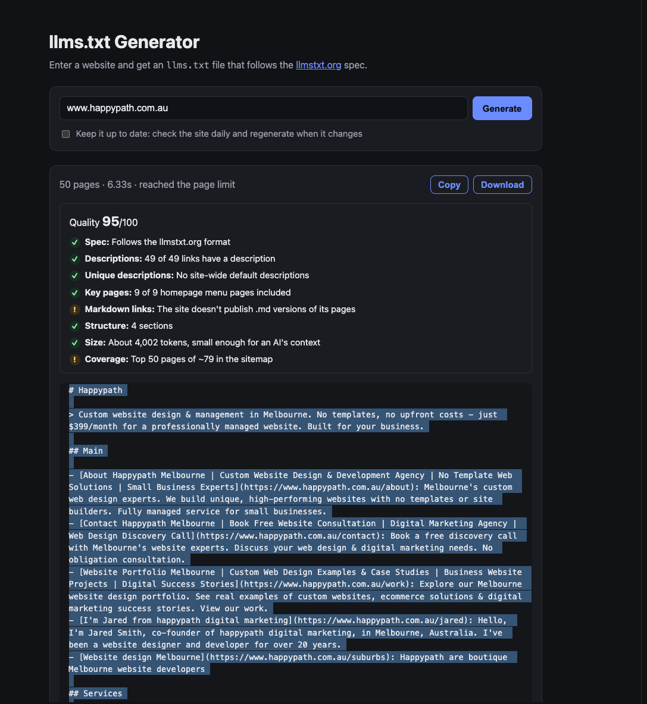

# llms.txt Generator

Enter a website URL and get an [`llms.txt`](https://llmstxt.org) file for it, with an
optional daily check that regenerates the file when the site changes.

**Live app:** https://web-production-905dcb88.up.railway.app



## Setup

### Option 1: Docker

```bash
cp .env.example .env
```

```bash
docker compose up --build
```

Open http://localhost:8000.

### Option 2: without Docker

Requires Python 3.12+ and Node 20+.

```bash
cp .env.example .env
```

```bash
cd backend && python3 -m venv .venv && .venv/bin/pip install -r requirements-dev.txt
```

```bash
cd frontend && npm install && npm run build
```

Start the server from the repo root:

```bash
backend/.venv/bin/uvicorn app.main:app --app-dir backend --reload --port 8000
```

Open http://localhost:8000. For frontend hot reload, also run `npm run dev` in
`frontend/` and open http://localhost:5173.

### Run the tests

```bash
cd backend && .venv/bin/python -m pytest
```

No API keys are needed. All settings are optional and listed in
[.env.example](.env.example). Design docs are in [docs/](docs/).
