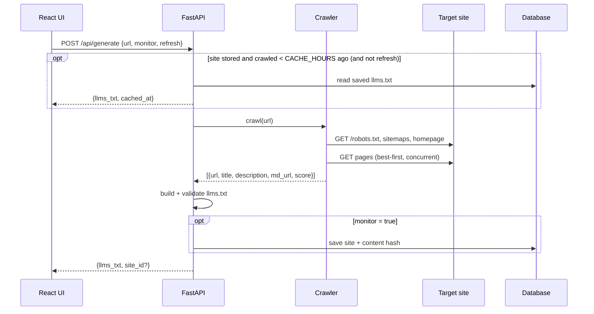

# Architecture

← Back to [PLAN.md](../PLAN.md)

## Generate request flow



## Components

| Module | Responsibility | Details |
|---|---|---|
| `urls.py` | URL normalization, scope and skip rules (pure functions) | [crawler.md](crawler.md#3-url-normalization) |
| `crawler.py` | The crawl itself: robots.txt, homepage, scored candidates, crawl loop | [crawler.md](crawler.md) |
| `scoring.py` | How the crawler ranks URLs (which to fetch next) | [crawler.md](crawler.md) |
| `fetcher.py` | One HTTP GET with a size cap and error codes instead of exceptions | [crawler.md](crawler.md) |
| `sitemaps.py` | Parse sitemap.xml and sitemap index files (pure functions) | [crawler.md](crawler.md) |
| `extract.py` | Pull title, description, markdown alternate from HTML | [llms-txt-format.md](llms-txt-format.md#where-each-value-comes-from) |
| `llmstxt.py` | Build + validate the llms.txt file | [llms-txt-format.md](llms-txt-format.md) |
| `generate.py` | Glue: crawl, then build + validate + quality report | below |
| `quality.py` | Score the generated file and list warnings | [code-walkthrough.md](code-walkthrough.md) |
| `monitor.py` | Scheduled ETag check, automatic re-crawl on change | [monitoring.md](monitoring.md) |
| `db.py` | SQLAlchemy models and SQLite session | [database.md](database.md) |
| `config.py` | All tunable settings (env-overridable) | [crawler.md](crawler.md#configuration) |
| `main.py` | FastAPI app, routes, serves the frontend build | below |

## API

| Method | Path | Purpose |
|---|---|---|
| POST | `/api/generate` | Crawl + generate; optionally start monitoring |
| GET | `/api/health` | Health check |
| GET | `/docs` | FastAPI's interactive API docs |
| GET | `/s/{id}/llms.txt` | Latest llms.txt for a monitored site (stable link) |
| GET | `/` | Serves the React build |

## Monitoring

- Every stored site gets an ETag check on a configurable interval (default daily):
  conditional GETs for the homepage, sitemaps and listed pages.
- If any ETag changed, or the last full crawl is over 7 days old, the site is re-crawled.
- A new version is saved only when the generated file's hash changes.

Full design: [monitoring.md](monitoring.md). Tables: [database.md](database.md).

## Frontend

- Single page: URL input, "Monitor this site" checkbox, Generate button.
- Loading state while crawling; clear error message on failure.
- Result: text area with Copy and Download (`llms.txt`) buttons; stable link if monitored.

## Repo layout

```
llms-txt-nishanth-mallekav/
├── backend/
│   ├── app/
│   │   ├── main.py
│   │   ├── config.py
│   │   ├── urls.py
│   │   ├── crawler.py
│   │   ├── scoring.py
│   │   ├── fetcher.py
│   │   ├── sitemaps.py
│   │   ├── extract.py
│   │   ├── llmstxt.py
│   │   ├── generate.py
│   │   ├── monitor.py
│   │   └── db.py
│   ├── scripts/compare.py # compare our output with a site's published llms.txt
│   ├── tests/
│   └── requirements.txt
├── frontend/              # React + Vite
├── docs/                  # design docs (this folder)
├── Dockerfile
├── docker-compose.yml     # local dev: app + ./data volume for SQLite
├── PLAN.md
└── README.md
```
