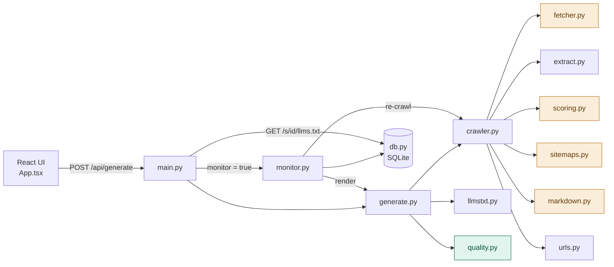
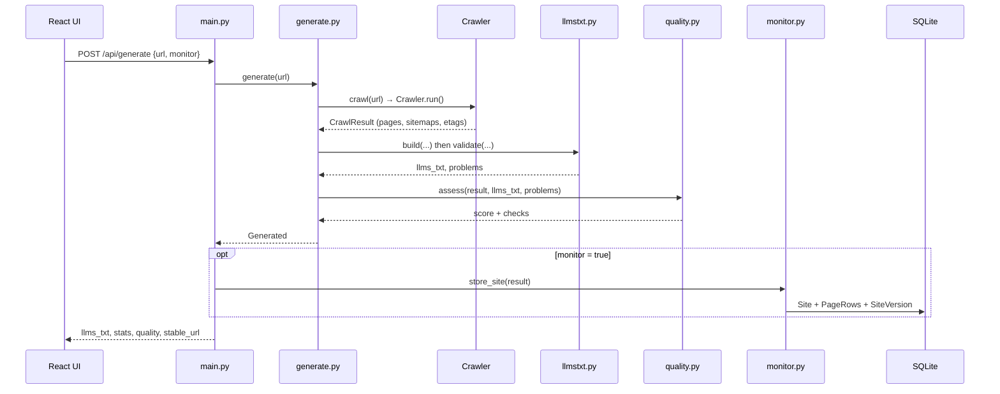

# Code Walkthrough

← Back to [PLAN.md](../PLAN.md)

A map of the backend code: which files exist, how they talk to each other,
and the steps each one goes through, so the logic is easy to follow without reading every line.

Read it top to bottom: the big picture, the overall flow as pseudocode, then one section
per file, starting from the entry point (`main.py`) and working down. Ideas for what to
build next are at the end.

---

## 1. The big picture

- **Orange boxes:** the helper files split out of `crawler.py` (`fetcher`, `scoring`, `sitemaps`, `markdown`). The crawler calls them; each does one job.
- **Green box:** `quality.py`, the quality report. It scores the finished file and lists what the site could improve.
- **Left half (generate):** turns a URL into an llms.txt file. None of these modules touch the database.
- **Right half (monitor):** stores sites, checks them on a schedule, and re-runs the
  same crawl + render when something changed.
- **Pure helpers** (`urls`, `extract`, `scoring`, `sitemaps`, `quality`) do no network I/O, which makes them easy to unit test.

---

## 2. Overall flow (pseudocode)

The whole app end to end, without splitting it by file.

**Generate a file (user clicks Generate):**
- User enters a URL (and optionally ticks "keep it up to date")
- If the site is already stored and was checked in the last 24 hours (and the user didn't click "Regenerate now"):
  - return the saved file, stats and quality report instantly; done
- Otherwise crawl it now:
- Clean up the URL; refuse it if it's invalid or points to a private/internal address
- Read the site's robots.txt (no robots.txt = everything allowed):
  - stop if it blocks the URL we were given
  - keep its rules: every link and sitemap URL is checked against them before it's queued
  - keep its `Crawl-delay`: if set, fetch one page at a time and wait between requests
  - keep its `Sitemap:` lines (if none, try `/sitemap.xml` and `/sitemap_index.xml`)
- Fetch the homepage; stop with an error if it fails
- If the homepage redirected, follow it to the new host/path (and read the new host's robots.txt)
- Read the site name and summary from the homepage
- Seed a priority queue:
  - every link on the homepage (menu links score highest)
  - every URL in the site's sitemaps
- Loop until 50 pages, 45 seconds, too many errors, or the queue is empty:
  - take the highest-scoring URLs off the queue
  - fetch them in parallel
  - for each page:
    - skip it if it's not HTML, a duplicate, or marked noindex
    - save its title: og:title, else `<title>`, else the first `<h1>` (with the site name removed)
    - save its description, taking the first one that exists:
      - `<meta name="description">` (written for Google)
      - else `og:description` (written for link previews)
      - else the first real paragraph on the page
      - else no description
    - save its ETag (used later to check if the page changed)
    - score its links and add them to the queue
- Look for markdown (.md) versions of the saved pages
- Build the llms.txt:
  - `# site name`
  - `> summary`
  - pages grouped into `## sections` by folder, best pages first
  - legal/careers pages last, under `## Optional`
- Check the file against the spec
- Score the file's quality (descriptions, key pages, .md links, size, coverage) and list warnings
- Show the quality report and the file to the user (Copy / Download)
- If the site was already stored, update it with this fresh crawl

**Start monitoring (if "keep it up to date" was ticked):**
- Save the site, its pages, their ETags and the first version of the file
- Give the site a stable link: `/s/{id}/llms.txt`
- Schedule its next check for 24 hours later

**Every 15 minutes (scheduler):**
- Find the sites whose next check is due
- For each site:
  - if its last full crawl was 7+ days ago → re-crawl
  - else ask the site if anything changed (send the saved ETags for the homepage, sitemaps and pages):
    - all unchanged → schedule the next check in 24 hours; done
    - check failed → retry in 6 hours; done
    - something changed → re-crawl
  - re-crawl: run the same crawl and build steps as above
  - if the new file is identical → keep the current version, just update the saved ETags
  - if it's different → save it as a new version; the stable link now serves it
  - schedule the next check in 24 hours

**Someone opens the stable link:**
- Look up the site and return its latest llms.txt

---

## 3. How a request flows through the files

---

## 4. File by file

Top-down: the entry point first, then each file in the order it calls the next.
Each section lists the high-level steps of what happens; see the code for details.

**Calls into another file are marked like this: → `file.function()`**

### `main.py`: the web app (entry point)

- **On startup:**
  1. Open the SQLite database **→ `db.init_db()`**
  2. Start the daily scheduler **→ `monitor.start_scheduler()`**
- **Generate request** (`POST /api/generate`):
  1. If the site is stored and was checked in the last 24 hours, return the saved version instantly **→ `monitor.cached_site()`**
     (skipped when the user clicks "Regenerate now", which sends `refresh: true`)
  2. Otherwise crawl the site and build the file **→ `generate.generate()`**
  3. If the site can't be crawled, return the error message to the UI.
  4. If "keep it up to date" is ticked, or the site is already stored, save it **→ `monitor.store_site()`**
  5. Return the llms.txt, crawl stats, quality report, whether it came from the cache, and the stable link if monitored.
- **Stable link** (`GET /s/{id}/llms.txt`): look up the site and return its latest llms.txt **→ `db`**
- **Everything else:** serve the React app.

### `generate.py`: crawl, build, then score

1. Crawl the site **→ `crawler.crawl()`**
2. Turn the crawled pages into llms.txt text **→ `llmstxt.build()`**
3. Check the text against the spec **→ `llmstxt.validate()`**
4. Score the file's quality **→ `quality.assess()`**
5. Return the text, the crawl result, any spec problems and the quality report.

### `crawler.py`: find the most important pages

1. Clean up the URL and refuse private/internal addresses **→ `urls.normalize()`**
2. Read the site's `robots.txt`; stop if it blocks us.
3. Fetch the homepage **→ `fetcher.fetch()`**; stop with an error if it fails.
4. If the homepage redirected, switch to the new host/path.
5. Read the homepage and save it as the first page **→ `extract.parse_html()`**
6. Queue every homepage link, each with a score **→ `scoring.score()`**
7. Queue every URL from the sitemaps **→ `sitemaps.parse_sitemap()`**
8. **Loop** until 50 pages, 45 seconds, too many errors, or nothing left to fetch:
   - take the best ~5 URLs off the queue (skipping sections that already have 15 pages)
   - fetch them in parallel
   - for each page: skip non-HTML pages, duplicates and `noindex` pages; save the title,
     description and ETag; score its links and add them to the queue
9. Look for `.md` versions of the saved pages **→ `markdown.find_markdown_versions()`**
10. Return the pages, the sitemaps, the ETags and why the crawl stopped.

The crawler uses these helpers:

#### `fetcher.py`: download a URL

1. Send a GET request.
2. Skip the body if it's too big or not useful (images, PDFs).
3. Return the status, headers and body. Errors come back as a value instead of crashing.

#### `urls.py`: URL rules

- Clean a URL so each page has one form (no tracking params, fragments, `index.html`, trailing slash).
- Check that a URL is on the same site and inside the crawl scope.
- Decide if a URL should be skipped: files, login/cart/search pages, tags, pagination, other languages.
- Work out a URL's section (`/docs/intro` → `docs`).
- Refuse private/internal addresses.

#### `extract.py`: read a page's HTML

1. Read the titles (`<title>`, `og:title`, `<h1>`).
2. Read the descriptions (meta description, `og:description`, first paragraph).
3. Read the site name, canonical URL, markdown link and `noindex` flag.
4. Collect every link and note where it appeared: nav, footer or body.
5. Clean up titles: "Home | Acme" → "Acme", "Pricing | Acme" → "Pricing".

**How each page's description is picked** (the site summary uses the same rule on the homepage):
- Nothing is AI-generated: it's copied from tags the site already has in each page's HTML `<head>`.
- First choice: `<meta name="description">`, the text written for Google search results.
- If missing: `<meta property="og:description">`, the text used for link previews on Slack, LinkedIn or X.
- If missing: the first real paragraph on the page (40+ characters, not in the menu or footer).
- If none exist: the link has no description, which the spec allows.
- If 3+ pages share the same description, it's a site-wide default, so those pages use their next option instead (handled in `llmstxt.py`).

#### `sitemaps.py`: read a sitemap

1. Unzip it if it's gzipped.
2. Return the page URLs it lists, or the other sitemaps if it's a sitemap index.

#### `scoring.py`: score a URL

1. Add points for where it was linked: homepage nav, sitemap, page body, footer.
2. Add points for each extra page linking to it, and for keywords like `docs` or `pricing`.
3. Subtract points for being deep, and for being in a section we already have many pages from.

Each URL is scored once, when it's added to the queue. The rules (weights can be changed in `.env`):

| Rule | Points | Setting |
|---|---|---|
| Linked from the homepage menu (nav/header) | +30 | `SCORE_NAV` |
| Listed in a sitemap | +15 | `SCORE_SITEMAP` |
| Sitemap `<priority>` (0–1) | + priority × 10 | `SCORE_SITEMAP_PRIORITY` |
| Linked from a page body | +10 | `SCORE_BODY` |
| Linked from a footer | +5 | `SCORE_FOOTER` |
| Each extra page linking to it | +3 | `SCORE_INBOUND` |
| Path has a keyword: `docs`, `documentation`, `guide(s)`, `api`, `getting-started`, `quickstart`, `reference`, `about`, `pricing`, `product(s)`, `features`, `faq` | +20 | `SCORE_KEYWORD` |
| Each folder level deep (`/a/b/c` = 3) | −8 each | `SCORE_DEPTH_PENALTY` |
| Each page already taken from its section | −5 each | `SCORE_SECTION_PENALTY` |

- Each link location counts once: 10 body links give +10, plus +3 for each extra page.
- The nav bonus only counts for links on the homepage, since the menu repeats on every page.
- The homepage itself isn't scored; it's always the first page.

#### `markdown.py`: find `.md` versions

1. For each saved page without a declared markdown version, try the usual URLs (`page.md`, `index.html.md`).
2. If one exists, link to it instead of the HTML page.

### `llmstxt.py`: build and check the file

**Build:**
1. Drop the homepage (its name and summary become the H1 and blockquote).
2. Replace descriptions shared by 3+ pages with each page's next option (`og:description` or first paragraph).
3. Remove duplicate pages.
4. Put legal/careers pages aside for `## Optional`.
5. Group the rest into sections: Main, one section per folder, Other for single pages.
6. Write `# Name`, `> summary`, each `## Section` with its links, then `## Optional`.

**Validate:**
1. Check the first line is the H1.
2. Check the parts are in the right order and there are no H3s.
3. Check every section holds only links, and Optional is last.
4. Return the list of problems (empty means valid).

### `quality.py`: score the file

Runs after the file is built, using the crawl result and the text. No extra requests.

1. Start at 100 points.
2. Run each check, marking it ok or warn and taking off points for weaknesses:
   - **Spec:** does the file pass the validator? (−40 if not)
   - **Descriptions:** how many links have a description? (up to −30)
   - **Unique descriptions:** did 3+ pages share a site-wide default? (−5)
   - **Key pages:** are all the homepage menu pages in the file? (up to −15)
   - **Markdown links:** does the site publish `.md` versions? (−5 if none)
   - **Structure:** between 1 and 12 sections? (−5 otherwise)
   - **Size:** under ~10,000 tokens? (−10 if over)
   - **Coverage:** did the crawl stop early, or is the site much bigger than 50 pages? (−10 if stopped early)
3. Return the score and the list of checks; the UI shows them above the file.

### `monitor.py`: keep stored sites up to date

**When a user turns on monitoring:**
1. Find or create the site in the database **→ `db`**
2. Build the llms.txt **→ `generate.render()`**, then save the pages, ETags and first version.
3. Save the crawl stats and quality report too, so a cached response can show them.
4. Schedule its next check for 24 hours later.

**When someone generates a stored site again** (`cached_site()`):
1. Look the site up by its URL **→ `db`**
2. If it was checked in the last 24 hours (`CACHE_MAX_AGE_HOURS`), hand back the saved version.
3. Otherwise return nothing, so `main.py` crawls fresh.

**Every 15 minutes (scheduler):**
1. Find the sites whose next check is due **→ `db`**
2. For each one:
   - if its last full crawl was 7+ days ago, re-crawl it
   - otherwise, ask the site whether anything changed (ETag check on the homepage, sitemaps and pages)
   - nothing changed → schedule the next check in 24 hours
   - the check failed → retry in 6 hours (after 3 failures, mark it failing)
   - something changed → re-crawl it **→ `crawler.crawl()`**
3. After a re-crawl, build the llms.txt again **→ `generate.render()`**
   - same as the current version → just update the stored pages and ETags
   - different → save it as a new version; the stable link serves it immediately

### `db.py`: the database

- Three tables:
  - `sites`: one row per monitored site, with its check schedule and ETags
  - `site_versions`: every llms.txt generated for a site
  - `pages`: the pages from the latest crawl, with their ETags
- On startup: create the tables, upgrade older databases, and turn on SQLite settings
  (WAL mode, foreign keys, busy timeout).

### `config.py`: settings

- Holds every tunable number: crawl limits, scoring weights, monitoring intervals, database path.
- Each one can be changed in `.env` or with an environment variable.

### `cli.py`: command line

1. Crawl and build for the URL given on the command line **→ `generate.generate()`**
2. Print the llms.txt (or save it to a file) and a short summary of the crawl.

### Frontend: `App.tsx`

1. The user enters a URL and optionally ticks "keep it up to date".
2. Send it to the backend **→ `POST /api/generate` in `main.py`**
3. Show a loading message, then the result: crawl stats, warnings, the stable link, and the file with Copy and Download buttons.
4. If the API returns an error, show its message.

---

## 5. Where to look when…

| You want to change… | Edit |
|---|---|
| How many pages, how long, how deep | `.env` / `config.py` (`CRAWL_*`) |
| What counts as important | `scoring.py` and the `SCORE_*` weights |
| Which URLs are skipped | `urls.skip_reason()` |
| How titles/descriptions are picked | `extract.py` |
| Section names, Optional rules, formatting | `llmstxt.py` |
| Quality checks and score | `quality.py` |
| How often sites are checked | `MONITOR_*` settings |
| What counts as "changed" | `monitor._check_one()` |
| API responses | `main.py` |

---

## 6. Improvements

Ideas for what to build next, most important first.

### 1. Render JavaScript websites

**The problem:** the crawler reads the HTML the server sends. Single-page apps (React,
Vue, Angular without server rendering) send an almost empty page and build the content in
the browser with JavaScript, so we see no links, no description and a thin llms.txt.

**The idea:** use a headless browser (Playwright with Chromium) for those sites only.
- Fetch the page normally first, as today (fast and cheap).
- Detect a JavaScript-only page, for example:
  - very little visible text, or only a few links
  - an empty app container like `

` or `

`
  - `<noscript>` messages like "You need to enable JavaScript"
- If it looks JavaScript-only, load it in the headless browser, wait for the page to
  settle, and read the rendered HTML instead.
- Pass the rendered HTML to the same `extract.parse_html()`, so nothing after the fetch changes.
- Remember per site that it needs rendering, so the rest of the crawl (and the monitor's
  re-crawls) use the browser straight away.

**Where it fits:** a new `renderer.py` next to `fetcher.py`. The crawler calls it only
when the plain fetch came back thin.

**Trade-offs:**
- Much slower: a rendered page takes ~1–3 seconds instead of ~100 ms, so the crawl would
  need a lower page budget or more time for these sites.
- Heavier: the Docker image grows by a few hundred MB for Chromium, and each browser tab
  needs memory. Limit to 1–2 tabs at a time.
- More things can break (timeouts, pop-ups, cookie banners), so keep the plain fetch as
  the fallback.

### 2. AI-written descriptions when the site has none

- Today a page with no meta description, no `og:description` and no clear paragraph gets
  no description.
- Send just those pages' text to an LLM and ask for a one-line summary.
- Only runs for the pages that need it, so it stays cheap. Needs an API key in `.env`.

### 3. Evaluate the file with an LLM

- Write 10–20 realistic questions per test site ("How do I set up webhooks?").
- Give an LLM only the llms.txt and check whether it picks the right page.
- Compare against the site's own llms.txt and against different scoring weights.
- Turns "is this file good?" into a number, and helps tune the scoring.

### 4. `llms-full.txt`

- The spec's companion file: the full markdown content of every listed page in one file.
- Built from the `.md` versions when the site has them, or converted from HTML otherwise.

### 5. Version history and diffs in the UI

- The database already keeps every version and a change summary ("+2 pages, 1 page updated").
- Show a history list for monitored sites and a side-by-side diff between versions.

### 6. Scale to many monitored sites

- Move the scheduler out of the web process into a job queue with workers (e.g. Redis + a worker pool).
- Switch from SQLite to Postgres so several workers can write at once.
- Add per-domain rate limits so we never hit one site with many crawls at the same time.
