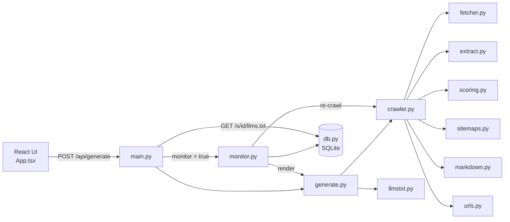
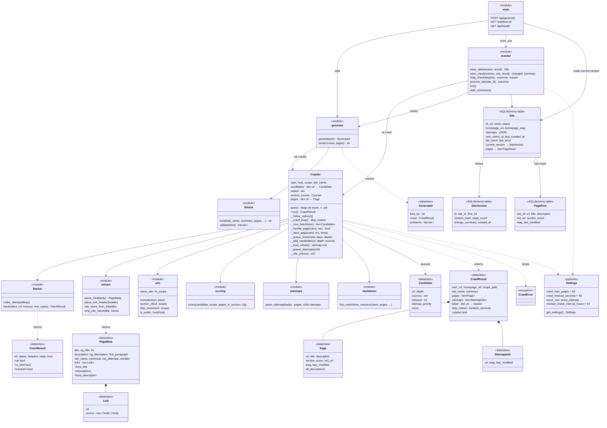
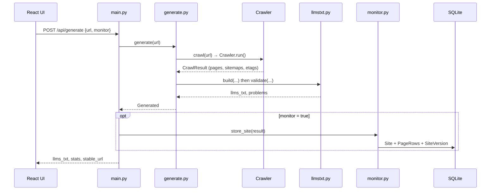

# Code Walkthrough

← Back to [PLAN.md](../PLAN.md)

A map of the backend code: which classes and modules exist, how they talk to each other,
and the steps each one goes through, so the logic is easy to follow without reading every line.

Read it top to bottom: the diagrams first, then one section per file, starting from the
entry point (`main.py`) and working down.

---

## 1. The big picture

- **Left half (generate):** turns a URL into an llms.txt file. None of these modules touch the database.
- **Right half (monitor):** stores sites, checks them on a schedule, and re-runs the
  same crawl + render when something changed.
- **Pure helpers** (`urls`, `extract`, `scoring`, `sitemaps`) do no network I/O, which makes them easy to unit test.

---

## 2. Class diagram

Boxes marked `<<module>>` are files of plain functions (no class); they're shown so you can
see who calls what. `<<dataclass>>` boxes are plain data holders.

### How a request flows through them

---

## 3. File by file

Top-down: the entry point first, then each file in the order it calls the next.
Each section is the high-level steps of what happens; see the code for details.

### `main.py`: the web app (entry point)

- On startup: set up logging, open the SQLite database, start the daily scheduler.
- **Generate request** (`POST /api/generate`):
  1. Call `generate` with the URL the user typed.
  2. If the site can't be crawled, return the error message to the UI.
  3. If "keep it up to date" is ticked, hand the crawl to `monitor` to store the site.
  4. Return the llms.txt, crawl stats, and the stable link if monitored.
- **Stable link** (`GET /s/{id}/llms.txt`): look up the site and return its latest llms.txt.
- **Everything else**: serve the React app.

### `generate.py`: crawl, then build

1. Crawl the site (`crawler`).
2. Turn the crawled pages into llms.txt text (`llmstxt.build`).
3. Check the text against the spec (`llmstxt.validate`).
4. Return the text, the crawl result and any spec problems.

The monitor reuses the same "build" step, so a re-crawl produces the file the same way.

### `crawler.py`: find the most important pages

1. Clean up the URL; refuse invalid URLs and private/internal addresses.
2. Read the site's `robots.txt`; stop if it blocks us.
3. Fetch the homepage; stop with an error if it fails.
4. If the homepage redirected, switch to the new host/path.
5. Save the homepage, and read the site name and summary from it.
6. Put every homepage link and every sitemap URL in the priority queue, each with a score.
7. **Loop** until 50 pages, 45 seconds, too many errors, or nothing left to fetch:
   - take the best ~5 URLs off the queue (re-scoring each, since sections fill up)
   - fetch them in parallel
   - for each page: skip non-HTML pages, duplicates and `noindex` pages; save the title,
     description and ETag; score its links and add them to the queue
8. Look for markdown (`.md`) versions of the saved pages.
9. Return the pages, the sitemaps, the ETags and why the crawl stopped.

The crawler uses these helpers:

#### `fetcher.py`: download a URL

1. Send a GET request.
2. Skip the body if it's too big or not useful (images, PDFs).
3. Return the status, headers and body. Errors come back as a value instead of crashing.

#### `urls.py`: URL rules

- Clean a URL so each page has one form (no tracking params, fragments, `index.html`, trailing slash).
- Check that a URL is on the same site and inside the crawl scope.
- Decide if a URL should be skipped: files, login/cart/search pages, tags, pagination, other languages.
- Work out a URL's section (`/docs/intro` → `docs`).
- Refuse private/internal addresses.

#### `extract.py`: read a page's HTML

1. Read the titles (`<title>`, `og:title`, `<h1>`).
2. Read the descriptions (meta description, `og:description`, first paragraph).
3. Read the site name, canonical URL, markdown link and `noindex` flag.
4. Collect every link and note where it appeared: nav, footer or body.
5. Clean up titles: "Home | Acme" → "Acme", "Pricing | Acme" → "Pricing".

#### `sitemaps.py`: read a sitemap

1. Unzip it if it's gzipped.
2. Return the page URLs it lists, or the other sitemaps if it's a sitemap index.

#### `scoring.py`: score a URL

1. Add points for where it was linked: homepage nav, sitemap, page body, footer.
2. Add points for each extra page linking to it, and for keywords like `docs` or `pricing`.
3. Subtract points for being deep, and for being in a section we already have many pages from.

#### `markdown.py`: find `.md` versions

1. For each saved page without a declared markdown version, try the usual URLs (`page.md`, `index.html.md`).
2. If one exists, link to it instead of the HTML page.

### `llmstxt.py`: build and check the file

**Build:**
1. Drop the homepage (its name and summary become the H1 and blockquote).
2. Replace descriptions that are the same on many pages with each page's own text.
3. Remove duplicate pages.
4. Put legal/careers pages aside for `## Optional`.
5. Group the rest into sections: Main, one section per folder, Other for single pages.
6. Write `# Name`, `> summary`, each `## Section` with its links, then `## Optional`.

**Validate:**
1. Check the first line is the H1.
2. Check the parts are in the right order and there are no H3s.
3. Check every section holds only links, and Optional is last.
4. Return the list of problems (empty means valid).

### `monitor.py`: keep stored sites up to date

**When a user turns on monitoring:**
1. Find or create the site in the database.
2. Save its pages, ETags and the first llms.txt version.
3. Schedule its next check for 24 hours later.

**Every 15 minutes (scheduler):**
1. Find the sites whose next check is due.
2. For each one:
   - if its last full crawl was 7+ days ago, re-crawl it
   - otherwise, ask the site whether anything changed (ETag check on the homepage, sitemaps and pages)
   - nothing changed → schedule the next check in 24 hours
   - the check failed → retry in 6 hours (after 3 failures, mark it failing)
   - something changed → re-crawl it
3. After a re-crawl, build the llms.txt again:
   - same as the current version → just update the stored pages and ETags
   - different → save it as a new version; the stable link serves it immediately

### `db.py`: the database

- Three tables:
  - `sites`: one row per monitored site, with its check schedule and ETags
  - `site_versions`: every llms.txt generated for a site
  - `pages`: the pages from the latest crawl, with their ETags
- On startup: create the tables, upgrade older databases, and turn on SQLite settings
  (WAL mode, foreign keys, busy timeout).

### `config.py`: settings

- Holds every tunable number: crawl limits, scoring weights, monitoring intervals, database path.
- Each one can be changed in `.env` or with an environment variable.

### `cli.py`: command line

1. Run `generate` for the URL given on the command line.
2. Print the llms.txt (or save it to a file) and a short summary of the crawl.

### Frontend: `App.tsx`

1. The user enters a URL and optionally ticks "keep it up to date".
2. Send it to `POST /api/generate` and show a loading message.
3. Show the result: crawl stats, warnings, the stable link, and the file with Copy and Download buttons.
4. If the API returns an error, show its message.

---

## 4. Where to look when…

| You want to change… | Edit |
|---|---|
| How many pages, how long, how deep | `.env` / `config.py` (`CRAWL_*`) |
| What counts as important | `scoring.py` and the `SCORE_*` weights |
| Which URLs are skipped | `urls.skip_reason()` |
| How titles/descriptions are picked | `extract.py` |
| Section names, Optional rules, formatting | `llmstxt.py` |
| How often sites are checked | `MONITOR_*` settings |
| What counts as "changed" | `monitor._check_one()` |
| API responses | `main.py` |
