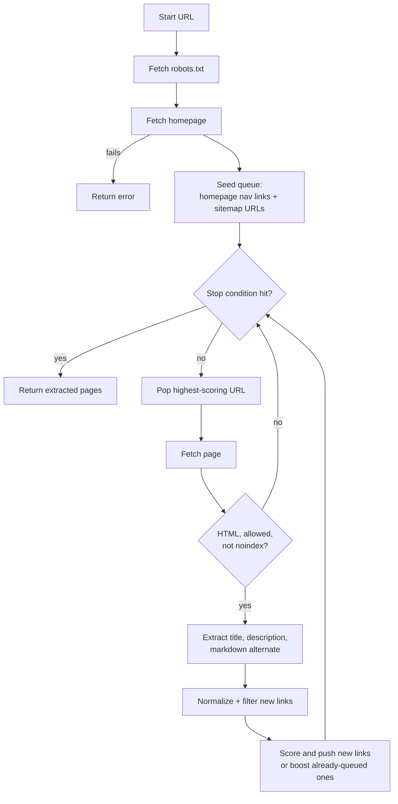

# Crawler Design

← Back to [PLAN.md](../PLAN.md)

How the crawler decides **which links to visit**, **in what order**, and **when to stop**.
The goal is not to crawl the whole site. It is to find the ~50 pages that best
describe it, because an llms.txt file is a curated overview, not a sitemap.

---

## Overview: best-first crawl

The crawler is a **best-first search** driven by a priority queue. Every discovered
link gets a score; the crawler always fetches the highest-scoring link next. When
the page budget runs out, we have the best pages seen so far, not just the first ones.

---

## 1. Discovering links

Sources, seeded into the queue before crawling starts:

1. **Sitemaps:** `Sitemap:` lines in `robots.txt`, then `/sitemap.xml`, then
   `/sitemap_index.xml`. Nested sitemap indexes are followed (max 5 sitemap files).
2. **Homepage navigation:** links inside `<nav>`, `<header>`, and `<footer>`.
3. **Page links:** links found on each fetched page, added as the crawl proceeds.

Seeding with sitemap and nav links up front gives the queue a good view of the site
before the greedy search begins.

## 2. Scope

- Same host only. `www.example.com` and `example.com` are treated as one site, and every
  URL is rewritten onto the homepage's scheme and host so they aren't counted twice.
- Private, loopback and link-local addresses are refused (SSRF protection), unless
  `CRAWL_ALLOW_PRIVATE_HOSTS=true`.
- If the user enters a subpath (e.g. `example.com/docs`), only URLs under `/docs`
  are crawled. This matches the spec: an llms.txt file covers the pages under its path.
- Redirects to another domain are dropped.

## 3. URL normalization

Applied to every link so each page is counted once:

- Resolve relative URLs against the page URL.
- Lowercase scheme and host; drop default ports.
- Remove `#fragment`.
- Remove tracking params: `utm_*`, `gclid`, `fbclid`, `ref`, `mc_cid`, `mc_eid`.
- Sort remaining query params.
- Consistent trailing slash (strip it, except for the root `/`).
- Fold `/index.html`, `/index.htm` and `/index.php` into the directory URL.
- After fetching, if the page declares `<link rel="canonical">` on the same host,
  record the page under the canonical URL.

## 4. Filtering (skip these links)

| Rule | Examples |
|---|---|
| Non-HTTP schemes | `mailto:`, `tel:`, `javascript:` |
| Non-HTML file extensions | `.pdf .jpg .png .gif .svg .zip .css .js .xml .mp4` |
| Utility pages | `/login`, `/signin`, `/signup`, `/register`, `/cart`, `/checkout`, `/account`, `/search`, `/admin` |
| Near-duplicates | `?page=2+`, `/page/2+`, `/tag/`, `/category/`, `/YYYY/MM/` archives |
| Other-language copies | `/fr/`, `/de/`, `/es/`, … when the start URL isn't under one |
| Disallowed | Paths blocked by `robots.txt` for our User-Agent |

Checked after fetching:

- `Content-Type` is not `text/html` → skip.
- `<meta name="robots" content="noindex">` → don't include in output.

---

## 5. Scoring (priority queue)

### Queue mechanics

- Python `heapq` (a min-heap) storing `(-score, counter, url)`. Negating the score
  pops the highest first; `counter` breaks ties in discovery order.
- A `candidates` dict tracks every queued URL and its signals. A URL found again gets
  its signals updated and is pushed with its higher score; it's still only fetched once.

### Score formula (higher = more important)

| Signal | Points |
|---|---|
| Linked from homepage nav / header | +30 |
| Listed in a sitemap | +15, plus `<priority>` × 10 if present |
| Linked from a page body | +10 |
| Linked from a footer | +5 |
| Each additional page linking to it | +3 |
| High-value path keyword (`docs`, `guide`, `api`, `getting-started`, `quickstart`, `reference`, `about`, `pricing`, `product`, `features`, `faq`) | +20 |
| Each path segment deep (`/a/b/c` = 3) | −8 |
| Each page already taken from the same section (counted when the URL is queued) | −5 |

A **section** is the first path segment under the scope (`/docs/...` → `docs`); top-level
pages (`/about`) have no section and go to **Main**; date-based paths (`/2024/05/post`)
form one `posts` section.

### Scored once, when queued

A URL is scored when it's added to the queue, and keeps that score until it's fetched.
If another page links to it later, it's pushed again with its new, higher score; the
older entry is skipped when it comes out because the URL is already visited.

The section penalty uses the number of pages taken from that section **at the time the
URL is queued**. Scores already in the queue aren't updated as a section fills up. That
keeps the queue simple; the section ceiling below stops any one section from dominating.

### Section ceiling

A hard ceiling of **15 pages per section** stops one huge section (e.g. `/blog`) from
taking the whole budget. Once a section has 15 pages, its remaining URLs are skipped.

### Known trade-off

Best-first is greedy: it can only rank links it has already discovered, so a valuable
page buried deep with no sitemap entry can be missed. Seeding from sitemaps and nav
links covers this for most real sites.

---

## 6. Stop conditions

The crawl ends at the **first** of these:

| Condition | Default |
|---|---|
| Pages fetched | 50 |
| Link depth from start URL | 3 |
| Total crawl time | 45s, then return what we have |
| Queue empty | — |

Early exits:

- Homepage fails to load → return a clear error (no partial result).
- 5 consecutive timeouts, network errors, `5xx` or `429 Too Many Requests` → stop, return partial results.
  A `403` on individual pages (usually login-only pages) doesn't count: a site that blocks us
  entirely already fails at the homepage.

## 7. Request limits and politeness

| Setting | Default |
|---|---|
| Concurrent requests | 5 |
| Per-request timeout | 10s |
| Max redirects | 5 |
| Max HTML body size | 2 MB (larger pages skipped) |
| `Crawl-delay` from robots.txt | Respected (requests become sequential with that delay) |
| User-Agent | `llms-txt-generator/1.0 (+<repo url>)` |

---

## 8. Markdown versions of pages

The spec asks that llms.txt links point to LLM-friendly content where it exists.
For each page we include, the crawler looks for a markdown version:

1. `<link rel="alternate" type="text/markdown" href="...">` in the page `<head>`.
2. The same relation in an HTTP `Link:` response header.
3. If neither is declared, a `HEAD` request for the spec's conventional URLs:
   `page.html` → `page.html.md`, `page` → `page.md`, `/dir/` → `/dir/index.html.md`
   or `/dir/index.md`. Accept only a `200` with a text/markdown or text/plain type.

If found, the llms.txt entry links to the markdown URL; otherwise to the HTML page.
Probes run only for pages that make it into the output, so they don't eat the crawl budget.

---

## Configuration

All numbers above live in `backend/app/config.py` and can be overridden with
environment variables (e.g. `CRAWL_MAX_PAGES=100`, `CRAWL_TIMEOUT_SECONDS=60`).
Weights are expected to be tuned after testing on real sites.
