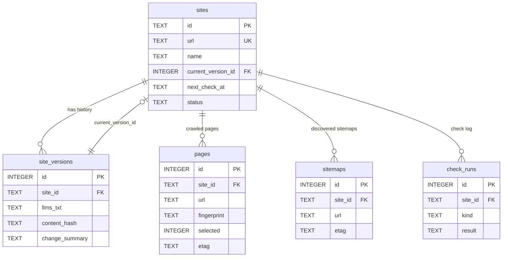

# Database

← Back to [PLAN.md](../PLAN.md)

All data lives in a single **SQLite** file (`/data/llms.db` in Docker, mounted on a
persistent volume). There is no Postgres. Access goes through SQLAlchemy in `backend/app/db.py`.

Only **monitored** sites are stored. A one-off "Generate" without monitoring writes nothing.

---

## Entity diagram



---

## Schema (SQLite DDL)

Timestamps are UTC, stored by SQLAlchemy as ISO-8601 strings. Booleans are `INTEGER` 0/1.
The models in `backend/app/db.py` create these tables on startup (`init_db`). The `CHECK`
constraints below document the allowed values; the code enforces them.

```sql
-- One row per monitored website.
CREATE TABLE sites (
    id                  TEXT PRIMARY KEY,          -- short random id, used in /s/{id}/llms.txt
    url                 TEXT NOT NULL UNIQUE,      -- normalized start URL (may include a subpath)
    name                TEXT,                      -- site name from the last crawl
    status              TEXT NOT NULL DEFAULT 'active'
                        CHECK (status IN ('active', 'paused', 'failing')),
    current_version_id  INTEGER REFERENCES site_versions(id),
    homepage_url        TEXT,                      -- homepage after redirects
    homepage_etag       TEXT,                      -- validators for the ETag check
    homepage_last_modified TEXT,
    scope_path          TEXT NOT NULL DEFAULT '/', -- crawl scope, e.g. /docs
    summary             TEXT,                      -- homepage summary from the last crawl
    created_at          TEXT NOT NULL,
    last_checked_at     TEXT,                      -- last ETag check (cheap)
    last_crawled_at     TEXT,                      -- last full crawl
    last_changed_at     TEXT,                      -- last time a new version was saved
    next_check_at       TEXT NOT NULL,             -- when the scheduler should check next
    fail_count          INTEGER NOT NULL DEFAULT 0,
    last_error          TEXT
);
CREATE INDEX idx_sites_next_check ON sites (status, next_check_at);

-- Every distinct llms.txt we have generated for a site. Newest = current.
CREATE TABLE site_versions (
    id              INTEGER PRIMARY KEY AUTOINCREMENT,
    site_id         TEXT NOT NULL REFERENCES sites(id) ON DELETE CASCADE,
    llms_txt        TEXT NOT NULL,
    content_hash    TEXT NOT NULL,                 -- sha256 of llms_txt
    page_count      INTEGER NOT NULL,
    change_summary  TEXT,                          -- e.g. "+3 pages, -1 page, 2 descriptions changed"
    created_at      TEXT NOT NULL
);
CREATE INDEX idx_versions_site ON site_versions (site_id, created_at DESC);

-- Pages from the latest crawl. Selected pages are the ones in the current file.
CREATE TABLE pages (
    id              INTEGER PRIMARY KEY AUTOINCREMENT,
    site_id         TEXT NOT NULL REFERENCES sites(id) ON DELETE CASCADE,
    url             TEXT NOT NULL,                 -- normalized / canonical URL
    title           TEXT,
    description     TEXT,
    alt_descriptions JSON,                         -- fallbacks if description is site-wide boilerplate
    md_url          TEXT,                          -- markdown version, if found
    section         TEXT NOT NULL,                 -- llms.txt H2 section this page belongs to
    score           REAL NOT NULL,                 -- crawler priority score
    selected        INTEGER NOT NULL DEFAULT 0,    -- 1 if included in the current llms.txt
    fingerprint     TEXT NOT NULL,                 -- sha256(url + title + description + md_url)
    etag            TEXT,
    last_modified   TEXT,
    http_status     INTEGER,
    last_fetched_at TEXT NOT NULL,
    UNIQUE (site_id, url)
);
CREATE INDEX idx_pages_selected ON pages (site_id, selected);

-- Sitemaps found for a site, so the ETag check can tell if they changed.
CREATE TABLE sitemaps (
    id              INTEGER PRIMARY KEY AUTOINCREMENT,
    site_id         TEXT NOT NULL REFERENCES sites(id) ON DELETE CASCADE,
    url             TEXT NOT NULL,
    etag            TEXT,
    last_modified   TEXT,
    UNIQUE (site_id, url)
);

-- Log of every ETag check and crawl, for debugging and the site status view.
CREATE TABLE check_runs (
    id              INTEGER PRIMARY KEY AUTOINCREMENT,
    site_id         TEXT NOT NULL REFERENCES sites(id) ON DELETE CASCADE,
    kind            TEXT NOT NULL CHECK (kind IN ('check', 'crawl')),
    trigger         TEXT NOT NULL CHECK (trigger IN ('initial', 'scheduled', 'change_detected', 'ttl', 'manual')),
    result          TEXT NOT NULL CHECK (result IN ('unchanged', 'changed', 'failed')),
    reason          TEXT,                          -- why a change was detected, or the error
    pages_fetched   INTEGER NOT NULL DEFAULT 0,
    started_at      TEXT NOT NULL,
    finished_at     TEXT
);
CREATE INDEX idx_runs_site ON check_runs (site_id, started_at DESC);
```

---

## How the tables are used

| Event | Writes |
|---|---|
| User generates with "Monitor" on | Insert `sites`, `site_versions` (v1), `pages`, `sitemaps`, `check_runs` (`crawl`, `initial`) |
| ETag check, all `304` | Update `sites.last_checked_at`, `next_check_at`; insert `check_runs` (`check`, `unchanged`) |
| ETag check finds a change | Insert `check_runs` (`check`, `changed`, reason = URL), then run a crawl |
| Re-crawl, output identical | Replace `pages` / `sitemaps` rows (new ETags); update `last_crawled_at`; no new version |
| Re-crawl, output differs | Same as above, plus insert `site_versions` and point `current_version_id` at it |
| Check or crawl fails | Increment `fail_count`, set `last_error`; current version untouched |
| `GET /s/{id}/llms.txt` | Read `site_versions` row at `current_version_id` |

---

## SQLite settings

Set on every connection in `db.py`:

```sql
PRAGMA journal_mode = WAL;     -- readers don't block the writer
PRAGMA foreign_keys = ON;      -- enforce REFERENCES / ON DELETE CASCADE
PRAGMA busy_timeout = 5000;    -- wait up to 5s instead of failing on a locked DB
```

Gotchas this design accounts for:

- **Single process.** SQLite allows one writer at a time, and APScheduler runs inside
  the app, so the app runs as **one uvicorn worker**. More workers would mean duplicate
  scheduled jobs and lock contention.
- **Persistent volume.** The DB file must live on a mounted volume (`/data`), or every
  redeploy wipes it. Railway supports volumes.
- **Writes in short transactions.** A crawl collects results in memory and writes them in
  one transaction at the end, so the DB is never locked for the length of a crawl.
- **Backups.** `sqlite3 /data/llms.db ".backup backup.db"` works while the app is running.
