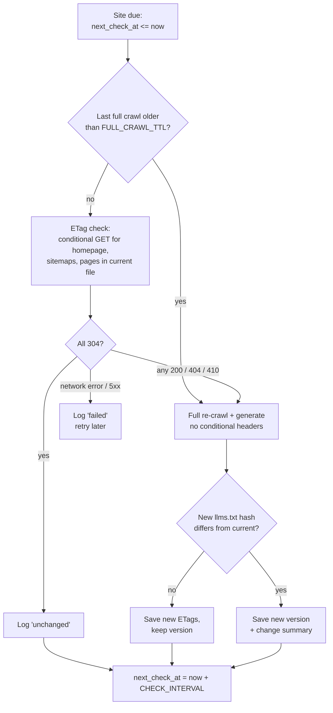

# Monitoring & Change Detection

← Back to [PLAN.md](../PLAN.md)

How stored sites stay up to date: on a configurable interval (default **every day**),
every site in the database gets an **ETag check**. If any ETag changed, the site is
**re-crawled automatically** and the new llms.txt is stored.

---

## How it works

1. **Detect (cheap):** for each stored site, send conditional requests with the saved
   `ETag`s. Any response other than `304 Not Modified` means something may have changed.
2. **Verify (exact):** re-crawl the site, regenerate llms.txt, and compare its hash with
   the current version. A new version is saved only if the hash differs.

The ETag check decides **when to pay for a crawl**. The file hash decides **whether to
publish**. A false alarm from the check only costs an extra crawl. It never creates a
new version on its own.

---

## Schedule

- Each site has `next_check_at`. After every check, `next_check_at = now + MONITOR_CHECK_INTERVAL_HOURS`
  (default **24**).
- An APScheduler job ticks every `MONITOR_TICK_MINUTES` (default 15) and processes up to
  `MONITOR_SITES_PER_TICK` sites where `next_check_at <= now`.
  Sites are checked around the time of day they were added, so checks spread out naturally.
- **Full-crawl backstop:** if a site's last full crawl is older than
  `MONITOR_FULL_CRAWL_TTL_DAYS` (default **7**), it is re-crawled even if
  every ETag returned `304`. See [why](#why-keep-the-full-crawl-backstop).

## The ETag check

URLs checked for each site, all saved by the last crawl (see [database.md](database.md)):

| URL | Why |
|---|---|
| Homepage | Site name, summary and nav links live here. New nav links usually mean new important pages. |
| Each sitemap | A changed sitemap means pages were added, removed or updated. |
| Each page in the current llms.txt | Its title or description may have changed. |

For each URL:

1. If we have an `ETag`, send `If-None-Match: <etag>`.
2. If there is no `ETag` but there is a `Last-Modified`, send `If-Modified-Since: <date>`.
3. If there is neither, the URL can't be checked cheaply, so we treat it as **changed**.

Then read the response:

| Response | Meaning |
|---|---|
| `304 Not Modified` | Unchanged |
| `200` with a different (or no) ETag | Changed |
| `200` with the **same** ETag | Unchanged: the server ignored `If-None-Match` (seen on Cloudflare) |
| `404` / `410` | Page removed, so changed |
| Timeout / `5xx` / connection error | Check failed, not a change. Retry later. |

URLs are checked one by one. The check **stops at the first changed URL** and starts the
re-crawl (or at the first failure, and retries later), so an unchanged
site costs one request per URL, almost all of them bodiless `304`s. The URL that
triggered it is written to the log, e.g. `HTTP 200: https://example.com/pricing`.

### Is the ETag reliable?

For our purpose, yes:

- A server returns `304` only when the ETag we send matches the one for the current
  response. In practice that is a hash or version of the content.
- **Weak ETags** (`W/"..."`) mean "equivalent content", not byte-identical. That's fine,
  because we only care about the title and description.
- When both headers are sent, the HTTP spec says `If-None-Match` wins over
  `If-Modified-Since`, so the ETag decides whenever one exists.

Known limits:

| Case | Effect |
|---|---|
| Server sends no validators (common on dynamic pages) | Treated as changed, so the site is re-crawled every check. Correct, just not cheap. |
| ETag rotates on every request (some load-balanced servers) | Same as above: an extra crawl, and the hash check prevents a false new version. |
| Only `Last-Modified`, set from a template file instead of the data | Can return `304` when content changed. **Weaker than ETag.** Caught by the full-crawl backstop. |
| CDN serving a stale cached copy | `304` while the origin changed. Visitors see the old content too; it resolves when the CDN cache expires. |

### Why keep the full-crawl backstop

The ETag check only covers pages we already list. A full crawl also catches:

- New pages linked only from pages we don't list, on sites without a sitemap.
- Ranking shifts: a page gaining inbound links that should now be selected.
- Wrong `304`s from the weaker cases above.

Worst-case staleness is therefore one check interval for most changes, and
`MONITOR_FULL_CRAWL_TTL_DAYS` for the rest.

---

## The re-crawl

- Runs the same full crawl and generator as the first time ([crawler.md](crawler.md)).
- Sends **no conditional headers**, so every page is downloaded fresh.
- Saves the new `ETag` / `Last-Modified` for the homepage, sitemaps and pages, for the
  next check.
- Compares `sha256(llms_txt)` with the current version:
  - **Same:** keep the version; only the stored pages and ETags are refreshed.
  - **Different:** store a new `site_versions` row and point `current_version_id` at it.
    The stable link `/s/{id}/llms.txt` serves it immediately.

### Change summary

Each page's `fingerprint = sha256(url + title + description + md_url)` is computed from the stored
row (not saved). When a new version is saved, old and new fingerprints produce a short summary,
e.g. `+3 pages, −1 page, 2 descriptions changed`, stored in `site_versions.change_summary`.

## Avoiding false alarms

- **Deterministic output:** pages are sorted by score, then URL, so identical input
  always produces an identical file.
- **Failed crawl:** if the homepage fails, nothing is saved and the current version stays.
- **Pages that fail during a re-crawl** (timeout, `5xx`, `404`) are left out of the new
  file. If that changes the output, a new version is saved.
- **Known limitation:** descriptions with live values ("Join 10,234 developers") change
  the real output, so they create a new version each time they change.

## Failures

- A failed check or crawl increments `sites.fail_count`, sets `last_error`, and retries
  after `MONITOR_RETRY_HOURS`.
- After `MONITOR_MAX_RETRIES` failures in a row, the site is marked `failing` and goes
  back to the normal interval until a check succeeds.

---

## Configuration

| Setting | Default | Meaning |
|---|---|---|
| `MONITOR_CHECK_INTERVAL_HOURS` | 24 | How often each site gets an ETag check |
| `MONITOR_FULL_CRAWL_TTL_DAYS` | 7 | Force a full crawl after this many days |
| `MONITOR_TICK_MINUTES` | 15 | How often the scheduler looks for due sites |
| `MONITOR_SITES_PER_TICK` | 5 | Max sites processed per tick |
| `MONITOR_RETRY_HOURS` | 6 | Retry delay after a failed check or crawl |
| `MONITOR_MAX_RETRIES` | 3 | Failures before a site is marked `failing` |
